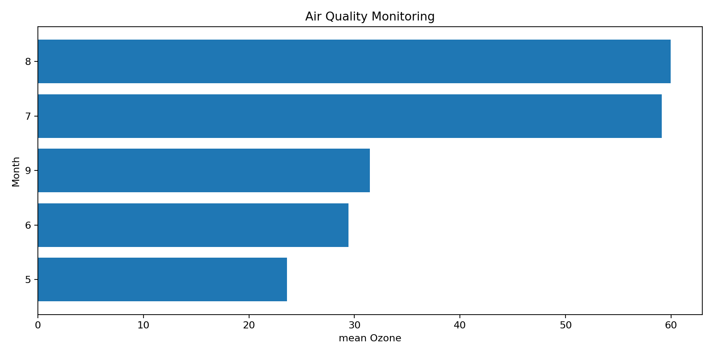

# Air Quality Monitoring — executed results

## Decision question
How does ozone concentration vary by month?

## Evidence
The largest observed mean Ozone is 59.962 for 8.0. This ranking is descriptive, not a recommendation.

Raw rows: 153. Rows used: 116. Excluded for missing/nonfinite required values or invalid denominator: 37.

## Method
Complete-case descriptive comparison of Ozone by Month; show group counts, mean, minimum and maximum.

## Interpretation and limitations
New York 1973 summer observations contain missing measurements and serial dependence. No causal inference, significance claim or production deployment is implied. Missing values are not imputed; identical rows are retained. Small or repeated samples limit uncertainty interpretation.

## Recommended next decision
Inspect monitoring coverage before comparing months.

## Reproducibility
Source and exact downloaded-byte SHA256 are recorded in run_manifest.json. SQL results are in answer.csv and analysis.sqlite. Review quality_audit.csv before interpretation.
